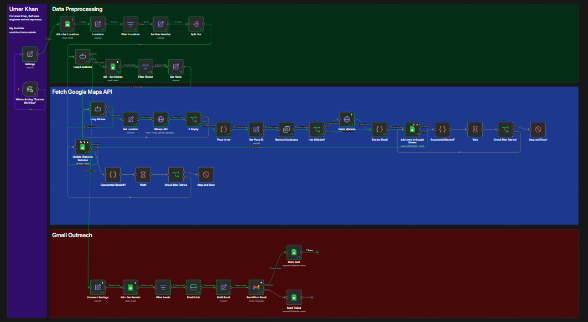

# Lead Scout

### From Locations to Leads

Lead Scout is an n8n-powered business discovery and lead generation workflow that automates prospect research using Google Sheets and a business-search API.

Define your target locations and business niches, let the workflow discover matching businesses, and collect the results in a structured output sheet. Lead Scout reduces repetitive research and creates a foundation for scalable outreach, offering an alternative to manually searching for prospects and sending cold emails one by one.

## Features

- **Location-Based Discovery:** Search for businesses across specified areas.
- **Niche Targeting:** Find businesses within selected industries or categories.
- **Automated Iteration:** Process multiple search targets through an n8n workflow.
- **Structured Lead Collection:** Store discovered business information in Google Sheets.
- **Contact Data:** Capture available email addresses when supported by the configured data sources.
- **Outreach Tracking:** Track email outreach status and sent timestamps in the results sheet.
- **Outreach Potential:** Connect collected leads to an email workflow for personalized, scalable outreach.

## Workflow

1. Define target locations in the `Locations` sheet.
2. Add business categories to the `Niches` sheet.
3. Read the search criteria through n8n.
4. Iterate through the configured locations and niches.
5. Query the business-search API.
6. Process and organize the returned business records.
7. Write results to the `Results` sheet.
8. Use available contact information for a separately configured outreach process.
9. Track outreach status and sent timestamps when email sending is configured.

## Architecture

Google Sheets → n8n → Business Search API → Data Processing → Results Sheet → Optional Email Outreach → Outreach Tracking

## Tech Stack

- **n8n:** Workflow automation
- **Google Sheets:** Input management and lead storage
- **Business Search API:** Business discovery
- **Google OAuth 2.0:** Google service authorization
- **Email Integration:** Optional outreach automation

## Getting Started

1. Import `lead_scout.json` into your n8n instance.
2. Configure Google Sheets credentials and the business-search API.
3. Connect the correct spreadsheet and verify the `Locations`, `Niches`, and `Results` sheets.
4. Confirm that all column names match the workflow mappings.
5. Test with one location and one niche.
6. Verify the results before expanding the search.

See [Manual.md](Manual.md) for setup instructions.

## License

Distributed under the MIT License if the included `LICENSE` file specifies MIT.

